<a href="https://starjnrdev.github.io"></a>




<a href="https://tracelens-app.vercel.app/"></a>

<a href="https://promptcheck-app.vercel.app/"></a>
<a href="https://seqcast.vercel.app/?demo"></a>

<a href="https://repo-hub-app.vercel.app/?demo"></a>
<a href="https://repo-doctor-app.vercel.app/"></a>

<a href="https://nuban-check.vercel.app/"></a>
<a href="https://naira-invoice-app.vercel.app/"></a>

Every tool is free to use at its live link. Source is private, except <a href="https://github.com/StarJnrDev/promptcheck">promptcheck</a>. Plus 227 AI coding challenges built for Shipd by Datacurve (private to the platform).


<a href="https://starnex.company"></a>
<a href="https://starapp.starnex.company"></a>

Code: <a href="https://github.com/StarNex-Company/starnex-landing">starnex-landing</a> · <a href="https://github.com/StarNex-Company/starapp-landing">starapp-landing</a>






Plain-text version

# Ayeni Oluwaferanmi Micheal

**Software Engineer · AI Evaluation · Full-Stack Development** · Ibadan, Nigeria · [Portfolio](https://starjnrdev.github.io)

I build the coding challenges that test how well frontier AI agents do real software engineering, and I build web products people use.

- **AI evaluation:** at [Shipd by Datacurve](https://shipd.ai) since October 2025, with 210 of 227 coding challenges approved (92%). Each challenge asks an AI agent to build a real feature inside a large open-source project, such as pip, Scrapy, BuildKit, Kustomize, HoloViews, Datashader or oxc.
- **Full-stack:** co-founder of [StarNex](https://starnex.company), a multi-venture company in Nigeria, where I build and launch our web products.
- **Education:** B.Sc. Computer Science, ESPAM Formation University, 2025.

## Selected work

| Project | What it solves | Built with |
| --- | --- | --- |
| **tracelens** · [live](https://tracelens-app.vercel.app/) | See what your AI coding agents actually did: session logs and evaluation run bundles, runs compared side by side with verdicts, tests and patches | React, TypeScript, Web Workers, SVG |
| **[promptcheck](https://github.com/StarJnrDev/promptcheck)** · [site](https://promptcheck-app.vercel.app/) | Regression tests for LLM prompts, with replayable recordings for free CI runs and JUnit, Markdown and HTML reports | Python, PyYAML, pytest |
| **seqcast** · [live](https://seqcast.vercel.app/?demo) | Forecasts how long an AI coding agent's run will be from a task and its reference solution: range, chance of reaching a target length, drivers (private code, server-side engine) | TypeScript, React, Vercel Functions |
| **repo-hub** · [live](https://repo-hub-app.vercel.app/?demo) | Scout open-source repos and design fair, hard benchmark tasks for AI coding agents: gates, testability, merged-PR mining, spec and audit | React, TypeScript, GitHub API |
| **repo-doctor** · [live](https://repo-doctor-app.vercel.app/) | Audit any GitHub profile the way a recruiter sees it, with a ranked fix list | TypeScript, GitHub REST API |
| **nuban-check** · [live](https://nuban-check.vercel.app/) | Validate Nigerian bank account numbers offline and repair payroll files where Excel stripped the leading zeros | TypeScript, zero dependencies |
| **naira-invoice** · [live](https://naira-invoice-app.vercel.app/) | Professional invoices for Nigerian freelancers: naira, VAT, amount in words, print-ready A4, offline | React, TypeScript, Tailwind CSS, PWA |
| **[StarNex website](https://starnex.company)** · [code](https://github.com/StarNex-Company/starnex-landing) | Company site for StarNex's technology, brand, growth and agriculture services | HTML, CSS, JavaScript |
| **[StarApp prelaunch site](https://starapp.starnex.company)** · [code](https://github.com/StarNex-Company/starapp-landing) | Prelaunch site with a Three.js brand mark and early-access sign-up | Next.js, TypeScript, Cloudflare D1 |

Every tool above is free to use at its live link. Source code is private, except promptcheck.

Plus 227 AI coding challenges built for Shipd by Datacurve (private to the platform).

## Skills

- **AI evaluation:** benchmark design, hidden test suites, mutation testing, false-positive audits, agent-behaviour tasks, ML competitions
- **Full-stack:** React, Next.js, Node.js, Tailwind CSS, Bootstrap, Three.js, PHP, Drizzle ORM, Cloudflare Workers and D1
- **Languages:** Python, TypeScript, JavaScript, PHP, HTML, CSS; working knowledge of Go and Rust
- **Tools:** Claude Code, OpenAI Codex, Docker, Git, GitHub Actions, pytest

## Get in touch

[Portfolio](https://starjnrdev.github.io) · [LinkedIn](https://www.linkedin.com/in/ayeni-oluwaferanmi-668ba6301) · [StarNex](https://starnex.company)

